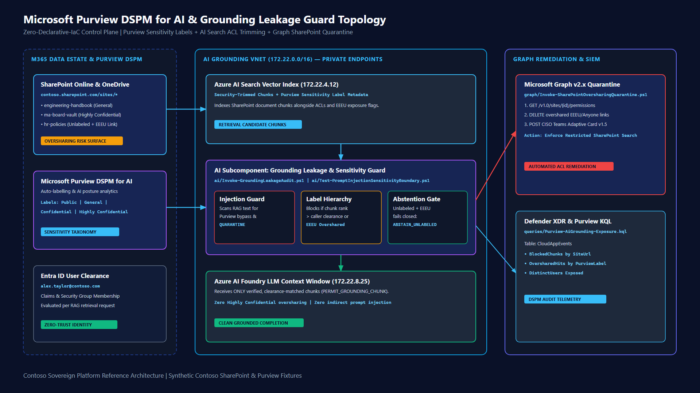
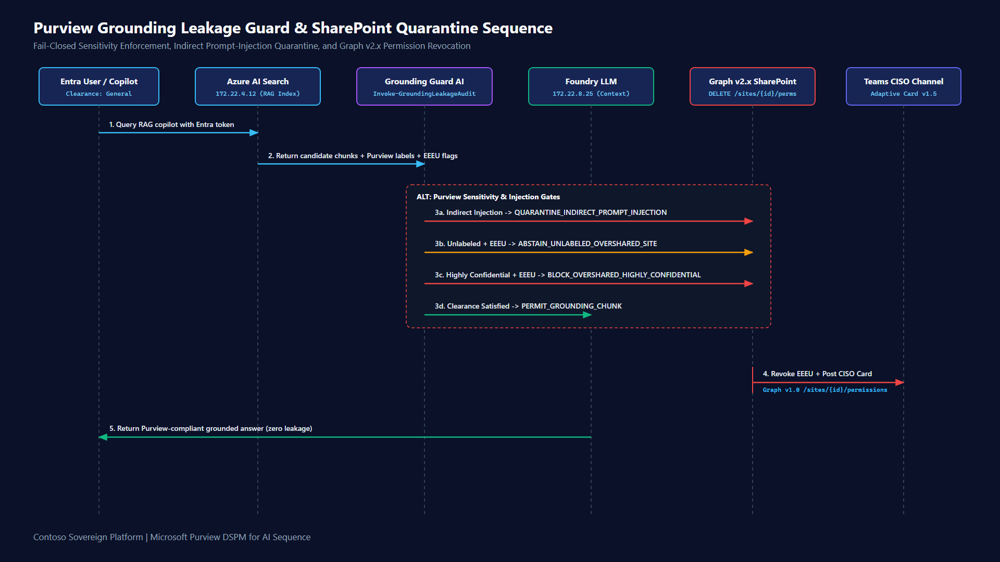

# Microsoft Purview DSPM for AI & Foundry Grounding Leakage Guard

[](https://learn.microsoft.com/powershell/)
[](https://learn.microsoft.com/graph/overview)
[](LICENSE)

> **Zero-Declarative-IaC Reference Architecture:** All Microsoft Purview sensitivity label grounding audits, indirect prompt-injection boundaries, SharePoint oversharing permission revocations (`Invoke-MgGraphRequest`), and CISO Teams escalations are implemented in deterministic PowerShell 7.4+.

---

## 1. Executive & C-Suite Business Value

### Business Risk: AI Grounding Accelerates Latent Oversharing
Enterprise SharePoint estates routinely accumulate years of `EveryoneExceptExternalUsers` (EEEU) and broad internal sharing links on M&A vaults, HR severance folders, and executive board packs. Before generative AI, those files remained buried in folder hierarchies. The moment an enterprise connects **Azure AI Search** or **Microsoft 365 Copilot** to SharePoint, semantic retrieval surfaces those overshared documents in seconds—turning latent permission debt into an immediate **UK-GDPR**, **DORA**, and **insider-threat** breach.

### Commercial ROI & Compliance Impact
| Metric | Unprotected RAG / Copilot Rollout | Purview DSPM + Grounding Leakage Guard |
| :--- | :--- | :--- |
| **Overshared `Highly Confidential` Exposure** | Surfaced in semantic search | **Blocked pre-LLM** + automated Graph ACL revocation |
| **Indirect Prompt Injection via SharePoint Docs** | Model follows embedded instructions | **Quarantined** by `Test-PromptInjectionSensitivityBoundary` |
| **Unlabeled Overshared Sites** | Grounded by default | **Fail-closed abstention** (`ABSTAIN_UNLABELED_OVERSHARED_SITE`) |
| **CISO Remediation Time** | Weeks of manual SharePoint audits | **Minutes** via Graph v2.x + Teams Adaptive Card |

- **Board-Level Regulatory Defensibility**: Every AI grounding block and SharePoint permission revocation emits a deterministic audit receipt, demonstrating active technical safeguards under UK-GDPR Article 32 and DORA ICT risk governance.

---

## 2. Chief Architect & Engineer Blueprint

### Epistemic Boundaries & Fail-Closed Grounding Controls
- **Indirect Prompt-Injection Boundary (`ai/Test-PromptInjectionSensitivityBoundary.ps1`):** Scans every retrieved RAG chunk before it enters the Foundry context window for instruction-override attempts targeting Purview labels or DLP rules.
- **Label Hierarchy & EEEU Gate (`ai/Invoke-GroundingLeakageAudit.ps1`):** Enforces strict rank comparison (`Public < General < Confidential < Highly Confidential`) against caller Entra clearance, blocks any `Highly Confidential` chunk exposed via EEEU, and abstains on unlabeled overshared sites.
- **Graph v2.x SharePoint Quarantine (`graph/Invoke-SharePointOversharingQuarantine.ps1`):** Queries `GET /v1.0/sites/{siteId}/permissions`, deletes `spo-grid-all-users` / `everyone` oversharing grants, and dispatches a CISO Teams Adaptive Card v1.5.

### Architecture & Sequence Diagrams





---

## 3. AI Subcomponent & Pilot Grafting Guide

### Repository Structure
- `ai/Invoke-GroundingLeakageAudit.ps1` — Purview label & caller clearance grounding evaluator.
- `ai/Test-PromptInjectionSensitivityBoundary.ps1` — Indirect prompt-injection detector for RAG chunks.
- `ai/dspm-grounding-eval-cases.json` — Synthetic Contoso evaluation matrix.
- `identity/PurviewIdentityClearance.psm1` — Microsoft Graph v2.x module for Entra ID caller clearance tiering and SharePoint oversharing audit/revocation.
- `graph/Invoke-SharePointOversharingQuarantine.ps1` — Microsoft Graph v2.x SharePoint ACL revocation & CISO Teams card dispatcher.
- `queries/Purview-AiGrounding-Exposure.kql` — Defender XDR `CloudAppEvents` KQL exposure query.
- `docs/DSPM-AI-GOVERNANCE-RUNBOOK.md` — L2/L3 Information Protection & RSS runbook.

### Chief Architect / Chief Engineer Pilot-Grafting Instructions
1. **Entra ID Workload Identity & Graph Scopes**: Assign a Managed Identity to your AI orchestration runner with `Sites.Selected` (or `Sites.FullControl.All` for tenant-wide quarantine), `GroupMember.Read.All`, `User.Read.All`, and `ChannelMessage.Send`.
2. **Graft Pre-LLM Grounding Gate**: Import `identity/PurviewIdentityClearance.psm1` in your Azure AI Search / Foundry retrieval pre-processor to resolve `Get-EntraCallerClearanceTier` before passing chunks to `ai/Invoke-GroundingLeakageAudit.ps1`—zero Bicep or Terraform required.
3. **Quarantine High-Risk Sites Before Copilot Onboarding**: Run `Test-SharePointSiteGuestExposure` across pilot SharePoint sites and pipe flagged grants to `Revoke-SharePointOversharingGrant -WhatIf` for CISO sign-off.

### Exact PowerShell & Pester 6.x Verification Commands
```powershell
# 1. Execute the full Pester 6.x verification suite
Invoke-Pester -Path ./tests/PurviewDspmAiGuard.Tests.ps1 -Output Detailed

# 2. Audit all synthetic Contoso SharePoint RAG grounding cases
$cases = Get-Content ./ai/dspm-grounding-eval-cases.json -Raw | ConvertFrom-Json
$cases | ForEach-Object { ./ai/Invoke-GroundingLeakageAudit.ps1 -GroundingCase $_ } | Format-Table CaseId, Decision, PermittedForGrounding, RequiresSiteQuarantine

# 3. Preview Microsoft Graph SharePoint Quarantine & CISO Teams Card (DryRun)
$verdict = ./ai/Invoke-GroundingLeakageAudit.ps1 -GroundingCase $cases[1]
./graph/Invoke-SharePointOversharingQuarantine.ps1 -AuditVerdict $verdict -SiteId 'contoso.sharepoint.com,1111,2222' -TeamId '00000000-0000-0000-0000-000000000001' -ChannelId '19:ciso@thread.tacv2' -DryRun
```

---

## 4. Microsoft Learn References
- [Microsoft Purview Data Security Posture Management (DSPM) for AI](https://learn.microsoft.com/en-us/purview/ai-microsoft-purview)
- [Restrict SharePoint Search (RSS) for Microsoft 365 Copilot](https://learn.microsoft.com/en-us/sharepoint/restricted-sharepoint-search)
- [Document-level access control in Azure AI Search](https://learn.microsoft.com/en-us/azure/search/search-security-trimming-for-azure-search)
- [Microsoft Graph SharePoint site permissions API](https://learn.microsoft.com/en-us/graph/api/site-list-permissions)
